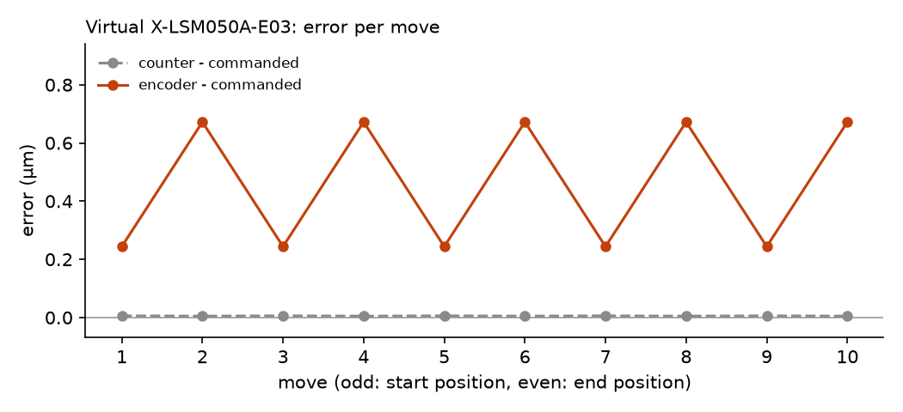

# zaber-virtual-scan

Back-and-forth repeatability test for one axis of a Zaber device or Zaber Virtual Device. After every move it waits a settle pause, re-reads the encoder (`encoder.pos`) until two reads agree, reads the controller's position counter (`pos`), and writes both to a CSV. Error is encoder minus commanded; without an encoder it is counter minus commanded and the CSV says so. Spread is reported separately for arrivals from each direction, and backlash as its own figure.



Virtual X-LSM050A-E03, 5 and 45 mm, 5 cycles at 25 mm/s: [sample/scan.csv](sample/scan.csv), [sample/run-output.txt](sample/run-output.txt). The Virtual Device returns a real `encoder.pos` that differs from the counter, and it gives the same value on every repeat: spread 0.000000 mm wherever a position was reached more than once, backlash 0, two reads per move. A simulator has no mechanical scatter or backlash; on hardware those show in the encoder column.

```sh
ZABER_CLOUD_ID=<cloud id> .venv/bin/python zaber_scan.py --cycles 5 --speed-mm-s 25
```

Independent example built on the public `zaber-motion` library. Not affiliated with or endorsed by Zaber Technologies.

## Setup

Python 3.10 or newer.

```sh
python3 -m venv .venv
.venv/bin/pip install -r requirements.txt

# See the planned moves; no device or network needed
.venv/bin/python zaber_scan.py --dry-run
```

Cloud ID without an account: open the Zaber Virtual Device viewer (software.zaber.com/virtual-device/viewer), pick a product, wait for the status to read "Running", and copy the Cloud ID shown at the top right. A guest device is deleted after four hours. For an account device, also set `ZABER_TOKEN` to an access token with the IoT scope.

A device on a serial port: `--port /dev/tty.usbserial-XXXX` (or `ZABER_PORT`) instead of the cloud ID.

## What each run does

1. Connects and lists the detected devices; selects `--device` and `--axis` (both 1-based, default 1).
2. Reads the axis travel limits and refuses a plan that leaves them.
3. Checks whether the axis answers `encoder.pos` and prints which error basis it will use.
4. Homes the axis.
5. For each move: `move_absolute` in mm at `--speed-mm-s`, waits until idle, pauses `--settle-ms`, then re-reads the encoder until two consecutive reads differ by at most `--stable-um` (at most `--max-reads` reads), and reads the counter. The row records how many reads it took and whether they settled; without an encoder the counter gets the same treatment.
6. Tags each arrival `forward` or `backward` by the direction the axis was moving when it got there (the first move comes from home).
7. Writes one CSV row per move (flushed immediately) and prints a summary.

Ctrl-C or a library error stops the axis, closes the connection and keeps the CSV rows written so far.

| Option | Default | Meaning |
|---|---|---|
| `--start-mm`, `--end-mm` | 5, 45 | The two positions |
| `--cycles` | 5 | Round trips (2 moves each) |
| `--speed-mm-s` | 20 | Move speed |
| `--tolerance-mm` | 0.01 | Largest accepted \|error\| |
| `--settle-ms` | 200 | Pause after each move before the first read |
| `--stable-um` | 0.1 | Two consecutive reads this close count as settled |
| `--max-reads` | 10 | Stop re-reading after this many reads |
| `--output` | scan.csv | CSV path |
| `--dry-run` | off | Print the plan and exit |

Exit codes: 0 all moves within tolerance, 1 Zaber library error, 2 bad arguments or plan outside travel, 3 a move outside tolerance, 130 interrupted.

CSV columns: `move, cycle, label, direction, commanded_mm, counter_mm, encoder_mm, error_mm, error_basis, reads, stable, within_tolerance, duration_s`. `encoder_mm` is empty and `error_basis` is `counter` when the axis has no encoder setting.

Plot from a CSV (matplotlib, in `requirements-dev.txt`):

```sh
.venv/bin/pip install -r requirements-dev.txt
.venv/bin/python plot_scan.py scan.csv --output scan.png
```

## Tests

```sh
.venv/bin/python -m pytest -q
```

They cover move planning, travel and tolerance checks, duration estimate, per-direction spread and backlash, the settle pause and stable-read loop, y-axis limits of the plot (negative encoder errors included), argument validation, plus `run()` against a fake connection and axis: encoder and counter columns, the counter-only fallback, Ctrl-C (rows kept, axis stopped, exit 130), a library error (axis stopped, exit 1), a plan outside the travel (refused, exit 2), an encoder error outside tolerance (exit 3) and no summary after a failed connection.

## Limits

- One axis per run. There is no X-Y raster scan: Virtual Devices offer only integrated single-axis products.
- A Virtual Device cannot show mechanical repeatability. On hardware the result is only as good as the encoder: the X-LSM-E series is listed in the viewer as "Motor Encoder", and a motor encoder is not a direct measurement of the carriage. Zaber's own accuracy example (`zaber-examples`, `self_test_direct_encoder_stage`) requires a direct encoder (-AE or -DE).
- Tested only against a Virtual X-LSM050A-E03 over the cloud. The `--port` path uses the same code after `Connection.open_serial_port` but has not been run on hardware.
- The reported encoder value is the last of the stable reads, not an average. Backlash is the difference of the mean readings at one position after arriving backward and forward; the sample plan reaches `start` forward only on the first move (from home) and `end` always forward, so it gives one forward arrival at `start`.
- The dry-run duration is a lower bound: travel at constant speed, ignoring acceleration.
- A device that reports the placeholder serial 4294967295 is shown as "serial not reported".

## Licence

MIT, see [LICENSE](LICENSE).
